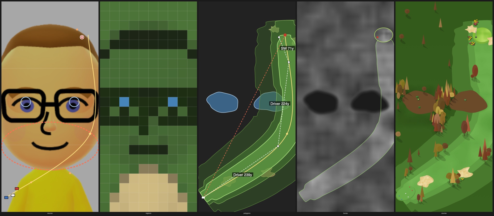
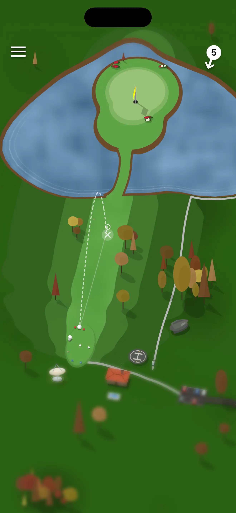

There's an old Sharp X68000 game called TIM COUNTRY CLUB (1994, Moai). It's a devilishly difficult and perhaps rather un-fun game of golf where your control of direction and power is severely constrained: the Dark Souls of golf games. But it does one interesting thing: it generates the course by manipulating and recolouring any image file you feed it. Some eight years ago I saw a video of that game and commented ["I think this is an interesting idea that could be expanded on"](https://www.youtube.com/watch?v=XewOeAinRT4), then promptly forgot all about it...until April 2026, when it came back to me whilst discussing [weird golf games](https://selectbutton.net/t/what-if-golf-but-weird/16859).

With it fresh in my mind, I wondered how I could take the high-level concept of turning an image into a hole of golf and do it in a modern way on an iPhone. I landed on a top-down golf game that reads a photo or image, does some edge, feature and colour detection, and translates the results into a golf course: blue eyes become lakes and the shape of a face dictates the bend of the fairway.

{:.tofigure}

I then dialled that concept up to 11. Everything in the game is procedurally generated from geometric primitives: think SVG rather than PNG. Not just the course features, but also the graphics and the biome themes (grass, desert, snow, and so on). The top-down view reminded me of tilt-shift photography, so I added some blur to make that a reality. I even went as far as filling the scene with trains, cars, animals and people to make it feel alive.

Then came the social side. Because everything is procedurally generated, a hole is just a seed, so a whole course of favourite holes fits in a short text code or QR code that friends can play exactly as you did. If another player is sitting nearby, a little satellite dish appears behind the tee: tap it to beam your current hole and your score straight to their device, StreetPass-style, with no accounts and no internet. The same dish glows gold once a day for the Daily 18: the same holes, wind and weather for everyone in the world, with Game Center leaderboards for Amateur and Pro, plus 12 achievements and a few secrets to find. All of this unlocks once you've played 19 holes, because where else would you socialise but the 19th hole?

{:width="320" height="695"}
{:.tofigure}

The hardest part of development wasn't the course generation or the physics, it was screen sizes. Between notches, Dynamic Islands, rounded corners, home indicators and the very different aspect ratios of iPad, every device needs its own safe area. The scenery needs to run edge to edge whilst the controls and scores stay clear of the unsafe bits, and on iPad that meant a lot of fighting with pillarboxing before it looked right. Controls ran a close second: it took many failed attempts before I realised I could use a second finger to shape shots, like plucking a bow.

Each of those achievements needed its own illustration, and after working so hard on the game I burned myself out drawing them. I put the game aside, only to be reminded a few months later by one of the testers that the TestFlight build had expired! Oops. Even then it took me another month or two to summon the energy to finish the Game Center artwork and submit it for review. May feels like a million years ago.

So, that's Snap Shot Golf to a tee: a casual golf game for iOS with Game Center support, sharing and competing with friends, and the ability to turn any photo into a hole of golf. And it's a mere 595 KB.

The price is the most golf-centric one I could think of: fore! (4 USD/GBP/EUR) ⛳️🏌️‍♂️

[gingerbeardman.com/apps/snap-shot-golf/](https://www.gingerbeardman.com/apps/snap-shot-golf/)

Have fun with it!